  
  
  
  

## Sobre mim

Sou consultor de automação de processos. Meu trabalho é encontrar a tarefa repetitiva que consome horas da equipe — conferir planilha, lançar dados no ERP, baixar relatório de portal — e transformá-la num robô confiável, que roda sozinho e avisa quando algo sai do esperado.

Programo em **Python** no dia a dia, integro sistemas legados como o **TOTVS Protheus** com plataformas web e APIs, e hoje estou levando **IA generativa** para dentro desses fluxos: extração de informações, geração de insights e atendimento inteligente.

## O que eu entrego

<table>
  <tr>
    <td width="50%" valign="top">

**Automação RPA ponta a ponta** 
Do mapeamento do processo ao robô em produção, com logs, tratamento de erro, versionamento e manutenção contínua.

</td>
    <td width="50%" valign="top">

**Coleta e extração de dados** 
Robôs que navegam portais e sistemas web e devolvem dados limpos, validados e prontos para uso.

</td>
  </tr>
  <tr>
    <td width="50%" valign="top">

**Integração entre sistemas** 
ERP, planilhas, APIs e sistemas internos conversando entre si, com orquestração via BPMS e sem digitação manual.

</td>
    <td width="50%" valign="top">

**IA aplicada a processos** 
LLMs dentro dos fluxos de automação: leitura de documentos, classificação, triagem e atendimento.

</td>
  </tr>
</table>

## Stack

| Área | Tecnologias |
| :-- | :-- |
| **Automação & RPA** |  ![Playwright](https://img.shields.io/badge/Playwright-161b2e?style=flat-square&logo=data%3Aimage%2Fsvg%2Bxml%3Bbase64%2CPHN2ZyB2aWV3Qm94PSIwIDAgNDAwIDQwMCIgeG1sbnM9Imh0dHA6Ly93d3cudzMub3JnLzIwMDAvc3ZnIj48cGF0aCBkPSJNMTYyIDI2MlYyNDBMOTkgMjU4Qzk5IDI1OCAxMDQgMjMxIDEzNiAyMjJDMTQ2IDIxOSAxNTUgMjE5IDE2MiAyMjBWMTI4SDE5M0MxODkgMTE4IDE4NiAxMTAgMTgzIDEwNEMxNzkgOTUgMTc0IDEwMSAxNjQgMTEwQzE1NiAxMTYgMTM3IDEyOSAxMDkgMTM3QzgwIDE0NSA1NyAxNDMgNDggMTQxQzM0IDEzOSAyNyAxMzYgMjggMTQ2QzI4IDE1NSAzMCAxNjkgMzUgMTg4QzQ2IDIyOCA4MiAzMDYgMTQ5IDI4OEMxNjcgMjg0IDE3OSAyNzQgMTg4IDI2MkgxNjJWMjYyWk02MSAxODhMMTA5IDE3NkMxMDkgMTc2IDEwOCAxOTQgOTAgMTk5QzcyIDIwNCA2MSAxODggNjEgMTg4WiIgZmlsbD0iI0UyNTc0QyIvPjxwYXRoIGQ9Ik0zNDIgMTI5QzMyOSAxMzEgMjk5IDEzNCAyNjMgMTI0QzIyNiAxMTQgMjAxIDk3IDE5MiA4OUMxNzggNzcgMTcyIDY5IDE2NiA4MUMxNjEgOTIgMTU0IDExMCAxNDcgMTM0QzEzMyAxODcgMTIzIDI5OCAyMTAgMzIxQzI5NyAzNDQgMzQ0IDI0MyAzNTggMTkwQzM2NCAxNjYgMzY3IDE0OCAzNjggMTM2QzM2OSAxMjIgMzU5IDEyNiAzNDIgMTI5Wk0xNjYgMTczQzE2NiAxNzMgMTgwIDE1MSAyMDQgMTU4QzIyNyAxNjUgMjI5IDE5MCAyMjkgMTkwTDE2NiAxNzNaTTIyMyAyNjlDMTgyIDI1NyAxNzYgMjI0IDE3NiAyMjRMMjg2IDI1NUMyODYgMjU1IDI2NCAyODEgMjIzIDI2OVpNMjYyIDIwMUMyNjIgMjAxIDI3NiAxODAgMjk5IDE4N0MzMjMgMTkzIDMyNSAyMTkgMzI1IDIxOUwyNjIgMjAxWiIgZmlsbD0iIzJFQUQzMyIvPjxwYXRoIGQ9Ik0xNDAgMjQ2TDk5IDI1OEM5OSAyNTggMTA0IDIzMiAxMzQgMjIyTDExMSAxMzZMMTA5IDEzN0M4MCAxNDUgNTcgMTQzIDQ4IDE0MUMzNCAxMzkgMjcgMTM2IDI4IDE0NkMyOCAxNTUgMzAgMTY5IDM1IDE4OEM0NiAyMjggODIgMzA2IDE0OSAyODhMMTUxIDI4OEwxNDAgMjQ2Wk02MSAxODhMMTA5IDE3NkMxMDkgMTc2IDEwOCAxOTQgOTAgMTk5QzcyIDIwNCA2MSAxODggNjEgMTg4WiIgZmlsbD0iI0Q2NTM0OCIvPjxwYXRoIGQ9Ik0yMjUgMjY5TDIyMyAyNjlDMTgyIDI1NyAxNzYgMjI0IDE3NiAyMjRMMjMzIDI0MEwyNjMgMTI0TDI2MyAxMjRDMjI2IDExNCAyMDEgOTcgMTkyIDg5QzE3OCA3NyAxNzIgNjkgMTY2IDgxQzE2MSA5MiAxNTQgMTEwIDE0NyAxMzRDMTMzIDE4NyAxMjMgMjk4IDIxMCAzMjFMMjEyIDMyMkwyMjUgMjY5Wk0xNjYgMTczQzE2NiAxNzMgMTgwIDE1MSAyMDQgMTU4QzIyNyAxNjUgMjI5IDE5MCAyMjkgMTkwTDE2NiAxNzNaIiBmaWxsPSIjMUQ4RDIyIi8%2BPHBhdGggZD0iTTE0MiAyNDVMMTMxIDI0OUMxMzQgMjYzIDEzOCAyNzcgMTQ1IDI4OUMxNDcgMjg5IDE0OCAyODkgMTQ5IDI4OEMxNTIgMjg3IDE1NSAyODYgMTU4IDI4NUMxNTAgMjczIDE0NSAyNjAgMTQyIDI0NVpNMTM4IDE0M0MxMzIgMTY0IDEyNyAxOTQgMTI4IDIyNEMxMzEgMjIzIDEzNCAyMjIgMTM2IDIyMkwxMzggMjIxQzEzNiAxODkgMTQxIDE1NiAxNDcgMTM0QzE0OSAxMjggMTUwIDEyMyAxNTIgMTE4QzE0OSAxMjAgMTQ3IDEyMSAxNDQgMTIzQzE0MiAxMjkgMTQwIDEzNiAxMzggMTQzWiIgZmlsbD0iI0MwNEI0MSIvPjwvc3ZnPg%3D%3D)       |
| **IA aplicada** |   |
| **Dados** |     |
| **APIs & mensageria** |    |
| **Web** |       |
| **Infra & ferramentas** |       |

## Projetos

| Projeto | Stack |
| :-- | :-- |
| **[CRM Jurídico](https://github.com/VictorHaddad/crm_adv)** · [demo ao vivo](https://victorhaddad.github.io/crm_adv/) Processos, prazos, clientes, agenda e financeiro para escritórios de advocacia. Protótipo com dados fictícios. | React 19 · TypeScript · Vite · Tailwind |
| **[Portfólio](https://github.com/VictorHaddad/portifolio)** · [site](https://portifolio-vhaddad.vercel.app/) Página única com tema cyber/tech e fundo 3D animado. | React · React Three Fiber · GSAP |
| **[Grupos da EBD](https://github.com/VictorHaddad/church-groups)** Ranking público de grupos e painel de líderes com chamada de presença e pontuação automática. | JavaScript |

A maior parte dos robôs que desenvolvo roda no ambiente dos clientes, por isso o código não é público. Cases e resultados eu mostro numa conversa.

## Atividade

<picture>
  <source media="(prefers-color-scheme: dark)" srcset="https://raw.githubusercontent.com/VictorHaddad/VictorHaddad/output/pacman-contribution-graph-dark.svg">
  <source media="(prefers-color-scheme: light)" srcset="https://raw.githubusercontent.com/VictorHaddad/VictorHaddad/output/pacman-contribution-graph.svg">
  
</picture>

Automatizar o repetitivo para sobrar tempo para o que importa.

